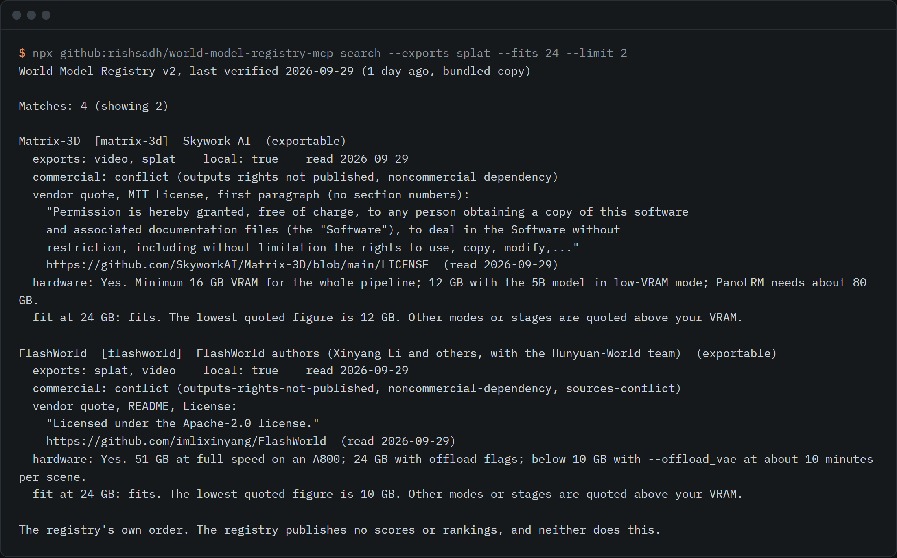

# world-model-registry-mcp

An MCP server and skill over the world model registry: which models export a splat, allow commercial use or fit 24 GB, with the quoted clause and read date.



```sh
npx github:rishsadh/world-model-registry-mcp search --exports splat --fits 24
```

The same queries run as seven MCP tools, so an agent gets the quoted clause and its date instead of a guess.

```sh
claude mcp add world-model-registry -- npx -y github:rishsadh/world-model-registry-mcp
```

## Why this exists

On 28 September 2026 AMD announced a definitive agreement to acquire World Labs, the company behind Marble
([AMD press release](https://ir.amd.com/news-events/press-releases/detail/1299/amd-to-acquire-world-labs-to-advance-the-future-of-ai-compute)).
When the registry re-read World Labs' pages on 29 September, the Terms of Service still carried the date
January 21, 2026 and did not mention AMD. Terms on these tools move, and the pages that say what you may do
with the output are rarely the pages that get written about.

The [World Model Registry](https://github.com/rishsadh/world-model-registry) by Rish Sadh records, for each world
model or scene generator, what you get as a file, what it costs and what you may do with it. Every figure and
clause is quoted from the vendor's page with the date it was read. It is a JSON file. This repo puts a query
layer on that file so an agent or a person can ask it questions.

A reading of it on 2026-09-29, using this tool: four models export a Gaussian splat and have a quoted GPU memory
figure at or below 24 GB (Matrix-3D, FlashWorld, WorldGen, WorldSplat). All four carry the commercial state
`conflict`, because a dependency or a weights licence is marked non-commercial, or the sources disagree. That is
the kind of answer a list of papers cannot give. Large world-model lists such as
[Awesome-World-Models](https://github.com/knightnemo/Awesome-World-Models) (read 2026-09-30) link papers and
say nothing about the licence of the models. This is a reading of the registry, not legal advice.

## Use it

### As an MCP server

Add it to any MCP client. The server speaks MCP over stdio and has no dependencies.

```json
{
  "mcpServers": {
    "world-model-registry": {
      "command": "npx",
      "args": ["-y", "github:rishsadh/world-model-registry-mcp"]
    }
  }
}
```

| Tool | What it answers |
|---|---|
| `registry_search` | Models by export (splat, mesh, panorama, video, point cloud), commercial state, local or hosted, open weights, GPU fit, reported fps |
| `registry_get` | One entry with every quoted grant and restriction, each with section, URL and read date |
| `registry_fit` | A VRAM size against the GPU memory figures the registry quotes |
| `registry_reported` | Frame rate, latency and generation time as vendors report them, with the hardware they named |
| `registry_changes` | What a clause, price or page said before and now, with the date read |
| `registry_choose` | A shortlist for a task, with the catches attached and the exclusions explained |
| `registry_info` | Which copy is loaded, how old it is, how to cite it |

All seven are read-only. Every result carries the registry version, the last-verified date and a note that the
clause can have changed since.

### As a skill

`skills/choose-a-world-model/SKILL.md` is an agent skill that turns "which world model should I use" into a fixed
procedure over those tools: get the job, the commercial need and the GPU, call `registry_choose`, read the clauses
before describing a licence, and answer with the quote, the read date and the catches. It forbids ranking and
forbids calling something safe unless a quoted clause says so.

```sh
npx github:rishsadh/world-model-registry-mcp skill --copy ~/.claude/skills
```

### From the command line

| Command | What it does |
|---|---|
| `search --exports splat --commercial usable --local --fits 24` | Filter the registry. Filters combine |
| `show marble` | Every quoted clause for one entry |
| `fit --vram 24` | Which models have a quoted GPU memory figure at or below 24 GB |
| `reported --min-fps 30` | Vendor-reported frame rates, with the sentence they came from |
| `changes --since 2026-09-01` | The registry's change log |
| `choose --task web-splat --fits 24` | A shortlist for a task: `walkthrough`, `game-prototype`, `web-splat`, `panorama-background`, `marketing-scene`, `realtime-interactive`, `robot-or-driving-sim` |
| `verify --write data/liveness.json` | Check that every source link answers |
| `awesome --write AWESOME.md` | Render the verified list |
| `update` | Download the current registry into your cache |

Add `--json` to any query to get the same structure the MCP tools return. Node 18 or later.

### How a commercial state is decided

The registry quotes clauses and gives no verdict. This tool sorts entries by rules you can read in
[`src/registry.mjs`](src/registry.mjs), applied to the registry's own text, and always returns the clauses beside
the state.

| State | Meaning |
|---|---|
| `quoted-grant` | A grant is quoted and no restriction is recorded |
| `licence-named` | A permissive licence is named in the registry's text, with no quoted clause on outputs |
| `conditions` | A grant is quoted with conditions attached: a territory exclusion, a user-count threshold, limits on training other models, attribution, a licence back to the vendor |
| `conflict` | A clause or source says no (a non-commercial dependency or weights licence, a commercial-use prohibition), or two sources disagree |
| `not-published` | The registry records no terms |

In the 2026-09-29 registry, of the 20 entries that are not announced-only, 8 are `conflict`, 8 are `conditions`, 1 is `licence-named`, 3 are `not-published` and none is `quoted-grant`. Nearly every quoted grant comes with conditions.

### Hardware fit and reported latency

`fit` takes the GPU memory figures the registry quotes, reads the lowest one from the registry's own summary line,
and compares it with your VRAM. Verdicts are `fits`, `exceeds`, `not-published`, `unknown` (no local run recorded)
and `hosted`. Figures for a single stage are flagged, so a 10 GB figure for one step is not read as the
requirement for the whole pipeline. System RAM is ignored.

`reported` returns the frame rates, latencies and generation times the registry quotes from vendor pages, each as
the sentence it appears in. These are vendor-reported. Nothing here measures anything.

### The verified list

[`AWESOME.md`](AWESOME.md) is the registry as an awesome-style list where every line carries the read date, the
commercial state and a link stamp. It is generated by `awesome` and is not edited by hand.

The first link check ran on 2026-09-30 over 135 source URLs: 133 live, 1 blocked (a Runway help page that refused
the automated request), 1 dead (`https://www.decart.ai/mirage` answers 404). A live link does not prove the quoted
text is still on the page, and a blocked one has not been checked. The record is in
[`data/liveness.json`](data/liveness.json).

[`.github/workflows/verify-links.yml`](.github/workflows/verify-links.yml) refreshes the registry copy, re-runs the
check and rebuilds the list. It runs every Monday at 05:17 UTC and can also be started by hand. A bot commits the
refreshed data and `AWESOME.md` to `main`.

### Keeping the data current

The package ships a copy of registry version 2, last verified 2026-09-29, with its SHA-256 in
[`data/snapshot.json`](data/snapshot.json). Every answer says how old the copy is, and warns after 30 days. Run
`update` to download the current registry from `rishsadh.com` into your cache; the newest copy wins.

## What it does not do

- It is not legal advice, and it does not read licences for you. It returns what the registry quoted, with the
  date. Open the source URL before relying on a clause, especially for client work.
- It does not re-read vendor pages. It is as fresh as the registry, and the registry is one person's record with
  read dates. A clause can change the day after.
- The commercial states are keyword rules on the registry's text. A rule can be wrong for a clause it was not
  written for. The clauses are always returned so the state can be checked.
- Latency is reported, not measured. There is no probe, and a figure with no hardware named cannot be compared.
- `fit` uses quoted figures only. It has no table of GPU names, and it cannot tell you how fast a model runs on
  your card. Where the registry says "not published", so does this.
- Licences for open-weight streamed models, such as Matrix-Game and LingBot-World, come from the registry's price
  text rather than quoted clauses, and are labelled `registry text`.
- No scores and no rankings. Results come back in the registry's own order.
- Wrappers that resell another model show the underlying model's terms, because those still govern the output.
- Object-level generators (a chair, not a room) are out of the registry's scope and listed by name only.

## Licence

Code: MIT. Data: the registry is CC BY 4.0, and the copy in `data/` keeps that licence. Cite it as in
[`data/README.md`](data/README.md). By [@rishsadh](https://github.com/rishsadh).
